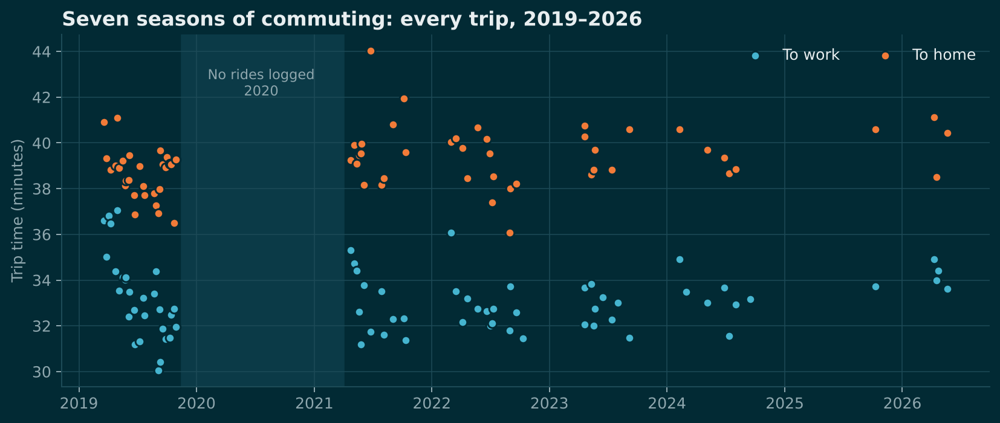
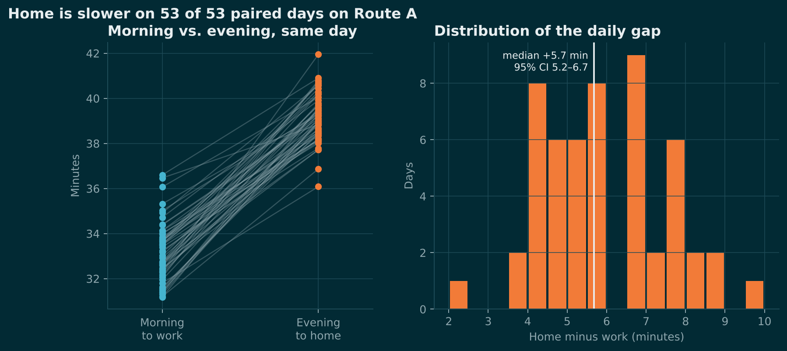
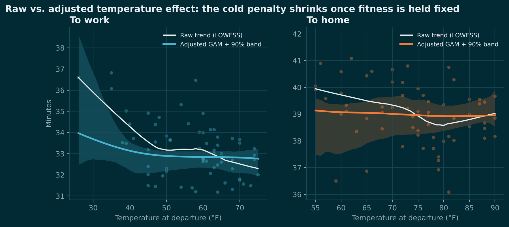
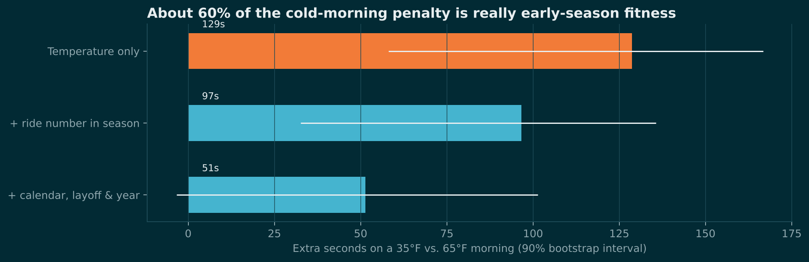
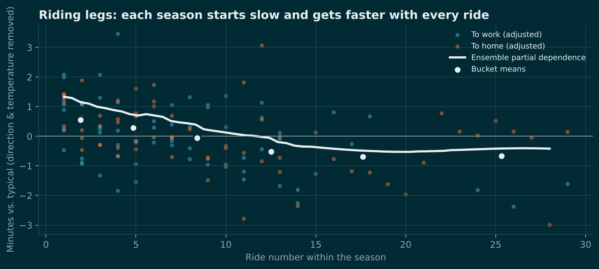
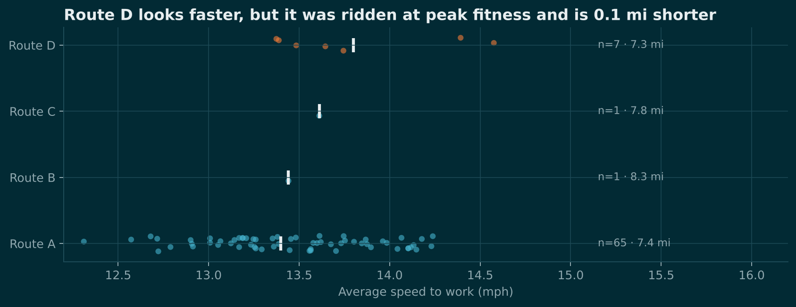
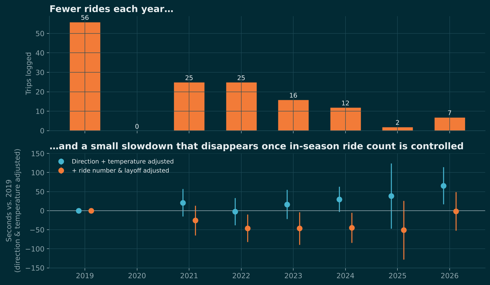
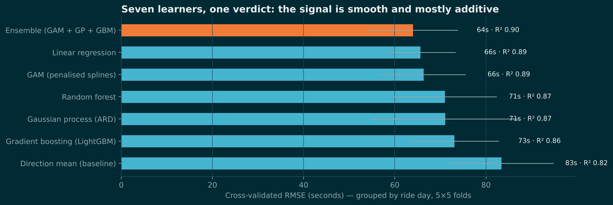
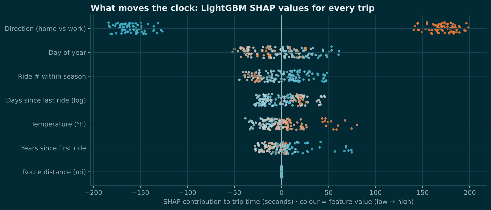

# The Commute, Decoded

**A statistical and machine-learning study of seven seasons of bicycle commuting (2019–2026)**

> 143 trips · 77 ride days · 1,060 miles · 85.9 hours in the saddle

Every number in this report comes from the reproducible pipeline in [`analysis/`](../analysis) (`python analysis/commute_analysis.py`). The full machine-readable output is in [`results.json`](results.json), and the interactive version of this story is in [`docs/index.html`](../docs/index.html).

---

## TL;DR

| # | Finding | Evidence |
|---|---|---|
| 1 | **The ride home is about 6 minutes slower, every single time.** | 53 of 53 paired same-route days; median gap **+5:41** (95% CI 5.2–6.7 min); adjusted effect **+6.38 min** |
| 2 | **Fitness builds within every season.** Each ride makes the next one faster, levelling off after about 15 rides. | **−4.5 s per ride** (95% CI −2.3 to −6.6 s, p < 0.001); about 75 s from first ride to peak form |
| 3 | **The "cold-morning penalty" is mostly an early-season penalty.** | Raw 35°F vs. 65°F penalty: **129 s** → **51 s** once ride number and calendar are controlled (**60% explained**) |
| 4 | **The rider isn't slowing down. They're riding less.** | Trips fell from 56 (2019) to 2–7 a year. The naive trend is **+5.2 s/yr**; with fitness controls it is **−5.5 s/yr**, and 2022–24 were about **45 s faster** than 2019 like-for-like |
| 5 | **Route D's speed edge is timing, not tarmac.** | Raw −85 s vs. Route A, but the adjusted effect is **−26 s**, matching the 27 s expected from being 0.1 mi shorter |
| 6 | **The signal is smooth and nearly additive.** Seven learners, including GP, LightGBM and RF, could not beat a well-specified linear model by much. | Ensemble CV-RMSE **64 s** (R² 0.90) vs. linear **66 s** vs. baseline **83 s** |

---

## 1. The data

| Field | Notes |
|---|---|
| `date` | 2019-03-20 → 2026-05-21; no rides in 2020; one ride day in 2025 |
| `temperature_f` | 26°F – 90°F at departure |
| `destination` | Work (morning) / Home (evening) |
| `time` | 30:03 – 44:02 |
| `route` | 7 routes (A–G); **Route A carries 91% of trips**; routes C, E, F, G have one trip each |

**Engineered features:** minutes, mph, direction flag, *ride number within season*, *days since previous ride* (log), day of year, years elapsed and route distance. Validation checks the schema, missing values, unknown routes and duplicate trips. The tests are in `analysis/tests/`.



---

## 2. What are the observations?

### 2.1 Direction dominates everything

On the **53 days** when Route A was ridden both ways, **the trip home was slower on all 53**.

| Metric | Value |
|---|---|
| Mean gap (home − work) | **+5.94 min** |
| Median gap | **+5.68 min** (bootstrap 95% CI 5.20–6.68) |
| Smallest / largest gap | 2.4 / 9.6 min |
| Paired t-test | t = 28.3, p ≈ 3e-33 |
| Wilcoxon signed-rank | p ≈ 2e-10 |
| Effect size (Cohen's d<sub>z</sub>) | **3.89** |

A **direction-only baseline already explains 82% of the variance** in trip time. Average speed is 13.4 mph going to work and 11.4 mph going home on the same 7.4-mile route.

**What the gap is *not*:**
- *Not temperature.* Evenings are 16.7°F warmer on average, but within the home direction temperature has no detectable effect (Section 3.2).
- *Not a "bad day."* A linear mixed model with a random intercept per ride day gives an ICC of about **0.00**. Once modelled factors are removed, a slow morning does not predict a slow evening (residual r = −0.23, p = 0.07).

A gap this consistent, 2:22 even on the best day, points to something **structural in the route**: a net climb toward home, prevailing afternoon headwinds, or evening traffic and signals. The data can't separate these, which is the first recommendation for future logging.



### 2.2 No weekday effect

Kruskal–Wallis on model residuals across weekdays gives H = 0.5, **p = 0.97**. The day of the week doesn't matter.

### 2.3 Outliers

The largest out-of-fold residuals from the best model:

| Date | Direction | Route | Actual | Expected | Residual |
|---|---|---|---|---|---|
| 2021-06-25 | Home | **B** | 44:02 | 39:35 | +4:27 |
| 2022-08-31 | Home | A | 36:05 | 39:23 | −3:18 |
| 2021-10-06 | Home | A | 41:57 | 39:01 | +2:56 |

The 2021-06-25 "anomaly" is really a limitation of the model. Route B is 0.9 mi longer, and at evening pace that alone is worth about 4.7 minutes. Tree models can't learn a distance effect from two trips, while the regression (+4.2 min for Route B) can.

---

## 3. How do different factors affect time?

### 3.1 Adjusted regression (OLS, HC1 robust SEs, R² = 0.91, residual SD = 62 s)

| Term | Effect | 95% CI | p |
|---|---|---|---|
| Direction: home | **+6.38 min** | 5.91 – 6.85 | < 1e-100 |
| Ride number in season | **−4.5 s / ride** | −6.6 – −2.3 | < 0.001 |
| log(days since last ride) | +9.3 s / log-day | −1.2 – +19.8 | 0.09 |
| Years elapsed | −5.1 s / year | −12.0 – +1.8 | 0.16 |
| Temperature (quadratic) | U-shape, minimum ≈ 76°F | 67 – 102°F | 0.004 / 0.016 |
| Route B (vs. A) | +4.19 min | 2.40 – 5.98 | < 0.001 |
| Route D (vs. A) | −0.43 min | −1.42 – +0.55 | 0.39 |

### 3.2 Temperature, the confounding trap

On raw numbers cold mornings look expensive. But **cold mornings happen early in the season**: temperature correlates with ride number (Spearman ρ = 0.46) and with day of year (ρ = 0.51), so early-season rides are both colder and less trained.

Adding controls step by step to work trips on Route A (35°F vs. 65°F, 2,000-draw bootstrap):

| Model | Cold penalty | 90% CI | R² |
|---|---|---|---|
| Temperature only | **129 s** | 58 – 167 s | 0.26 |
| + ride number in season | **97 s** | 33 – 136 s | 0.43 |
| + calendar, layoff & year | **51 s** | −3 – 101 s | 0.53 |

**About 60% of the apparent cold penalty is really early-season fitness.** What remains is under a minute, and its 90% interval now includes zero. On the **ride home, temperature has no detectable effect anywhere from 55°F to 90°F**, so heat costs nothing measurable.

The non-parametric models expose the same collinearity. The ARD Gaussian process pushes temperature's length-scale to its upper bound and credits the seasonal signal entirely to ride number, while LightGBM spreads the credit across temperature, day of year and ride number. When drivers move together, picking a single "cause" is a modelling choice, so the honest answer is a **range of 51–129 s**.




### 3.3 Fitness: the in-season learning curve

| Ride # (bucket) | Adjusted time vs. typical |
|---|---|
| 1–3 | **+34 s** |
| 4–6 | +17 s |
| 7–10 | −3 s |
| 11–15 | −31 s |
| 16–20 | **−42 s** |
| 21–30 | −40 s |

Non-parametric partial dependence (ensemble and GP) shows a **concave learning curve**: steep for the first dozen rides, flat after about 15. Time off the bike adds a little rust on top. Partial dependence on days since the last ride rises steadily on a log scale, consistent with the OLS coefficient.



### 3.4 Routes

| Route | Distance | Trips | Mean speed |
|---|---|---|---|
| A | 7.4 mi | 130 | 13.4 mph to work / 11.4 mph home |
| D | 7.3 mi | 7 (all to work) | 13.8 mph |
| B | 8.3 mi | 2 | 13.4 / 11.3 mph |
| C, E, F, G | 7.3–7.8 mi | 1 each | — |

Route D *looks* faster: 31:46 vs. 33:11 to work (Mann–Whitney p = 0.01). But all D rides were in late summer and autumn, at peak fitness. Within the same autumn-2019 window, A averaged 32:04 vs. D's 31:43 (p = 0.46). The adjusted D effect, **−26 s**, is almost exactly what 0.1 fewer miles at 13.4 mph predicts (**−27 s**). **Speed is the same on both roads; D is simply shorter.**



---

## 4. How would you describe trends and changes over time?

### 4.1 Frequency collapsed

| Season | 2019 | 2020 | 2021 | 2022 | 2023 | 2024 | 2025 | 2026 (to May) |
|---|---|---|---|---|---|---|---|---|
| Trips | **56** | 0 | 25 | 25 | 16 | 12 | 2 | 7 |

The 2020 gap and the post-2019 drop line up with a pandemic-era shift toward remote or hybrid work, though that is an inference and not in the data.

### 4.2 A spurious slowdown

| Specification | Trend |
|---|---|
| Direction + temperature only | **+5.2 s / year** slower (p = 0.08) |
| + ride number & layoff | **−5.5 s / year** faster (p = 0.13) |
| Theil–Sen on residuals | −3.8 s / year (95% CI −9.5 to +1.6) |

Season fixed effects tell the same story. Adjusted only for direction and temperature, every season after 2019 looks slower (2026: **+66 s**, CI excludes 0). Once ride number and layoff are added, the signs flip: **2022, 2023 and 2024 are each about 45 s *faster* than 2019** with intervals excluding zero, and 2026 is level.

**Interpretation:** fewer rides per season mean the rider spends more of each season on the slow, early part of the fitness curve. The decline is in the riding habit, not in the rider. This is a Simpson's-paradox-style reversal, and the most important "critical thinking" result in the analysis.



---

## 5. Machine learning: non-parametric relationships

### 5.1 Setup

- **Features:** direction, temperature, day of year, ride number in season, log days since last ride, years elapsed, route distance.
- **Validation:** 5-fold × 5-repeat cross-validation **grouped by ride day**, so the morning and evening trips of one day never straddle train and test. A second check uses **forward-chaining, season-ahead** evaluation.
- **Models:** direction-mean baseline · linear regression · penalised-spline GAM (cubic B-splines + ridge, GCV-tuned) · random forest · LightGBM · Gaussian process with an ARD RBF kernel and learned noise · averaging ensemble of GAM + GP + LightGBM.

### 5.2 Leaderboard

| Model | CV RMSE | CV MAE | R² |
|---|---|---|---|
| **Ensemble (GAM + GP + GBM)** | **64 s** | **51 s** | **0.895** |
| Linear regression | 66 s | 53 s | 0.889 |
| GAM (penalised splines) | 66 s | 53 s | 0.887 |
| Random forest | 71 s | 55 s | 0.871 |
| Gaussian process (ARD) | 71 s | 54 s | 0.869 |
| Gradient boosting (LightGBM) | 73 s | 57 s | 0.863 |
| Direction mean (baseline) | 83 s | 65 s | 0.820 |



**Reading this honestly:** the flexible learners found **no hidden thresholds or interactions** worth more than a couple of seconds. The relationships are smooth and close to additive, and about **one minute of trip-to-day noise is irreducible** with these features. This kind of check is how you earn the right to ship a simple model.

Forward-in-time validation adds a caution. Splines on *years elapsed* extrapolate badly when only one or two seasons are available for training (GAM error of 198 s and 131 s in 2022–23). The tree models and the GP degrade gracefully, which is one reason to ensemble.

### 5.3 Interpretation: three lenses

| Feature | Tree SHAP (mean \|φ\|) | Permutation ΔRMSE (LightGBM) | GP relevance (1/ℓ, scaled) |
|---|---|---|---|
| Direction | **165 s** | **210 s** | **1.00** |
| Day of year | 23 s | 26 s | 0.00 |
| Ride # in season | 20 s | 21 s | 0.66 |
| Days since last ride | 17 s | 17 s | 0.08 |
| Temperature | 17 s | 20 s | 0.00 |
| Years elapsed | 14 s | 18 s | 0.67 |
| Route distance | 0 s | 0 s | 0.19 |

All three methods agree that direction comes first and fitness second. They split credit differently among the three collinear seasonal drivers. SHAP interaction values and accumulated local effects (ALE, which is robust to correlated features) were used to confirm there is **no meaningful temperature × direction interaction** once fitness is in the model.



### 5.4 Uncertainty: conformal prediction

The best model is wrapped in **split-conformal prediction** to give distribution-free intervals:

- 90% interval half-width from out-of-fold residuals: **±1:43**
- Empirical coverage over 60 random day-level train/calibrate/test splits: **96%** (target 90%; slightly conservative on n = 143)

This powers the **ride planner** on the website. Choose a direction, temperature, month and ride number to get an expected time and a **leave-by time that arrives on time 9 trips in 10**.

---

## 6. What are the implications?

1. **Budget the trip home separately.** Plan on about 33 minutes in and 39 out. Using the morning time for the evening leaves the rider 5–6 minutes short every day.
2. **Consistency is the biggest controllable lever.** More rides per season keep the rider on the fast, flat part of the fitness curve. The apparent decline since 2019 is a frequency effect, so even two rides a week would recover most of the 30–40 s early-season penalty.
3. **Dress for the cold, but don't blame it.** Once fitness is accounted for, a truly cold morning costs under a minute, and heat costs nothing up to 90°F. Weather is rarely a good reason to skip a ride.
4. **Choose routes for reasons other than speed.** Route D's edge is distance (about 25 s), and Route B costs about 4 minutes. A real speed comparison would need matched days, ideally alternating A and D in the same weeks.
5. **Log a few more variables.** Departure time, wind speed and direction, and precipitation would explain the home-direction gap. Joining a historical weather API on date would add wind and rain retroactively.
6. **The same trap shows up in client work.** Temperature, season and fitness moved together here, just as seasonality, spend and promotions move together in marketing data. The obvious driver (cold) turned out to be largely a proxy, and checking for confounding before naming a driver avoids recommending the wrong lever.

---

## 7. Caveats

- **Small sample:** 143 trips, 77 days. Six minor routes have 7 trips between them.
- **Unmeasured confounders:** departure time, wind, rain, traffic, bike and gear changes, and route geometry. "Direction" absorbs everything that differs between morning and evening.
- **Observational data:** effects are associations, not causal estimates. The rider chose when to ride, so fair-weather selection is likely.
- **Season definition:** a season is a calendar year. One February 2024 ride is counted as ride #1 of that season.

---

## 8. Reproduce

```bash
cd analysis
pip install -r requirements.txt
python commute_analysis.py
python -m pytest tests
```

Outputs:
- `reports/results.json`: every statistic in this report
- `reports/figures/*.png`: static figures
- `docs/data/analysis.js`: data feed for the interactive site
- `analysis/data/trips_features.csv`: the engineered feature table
